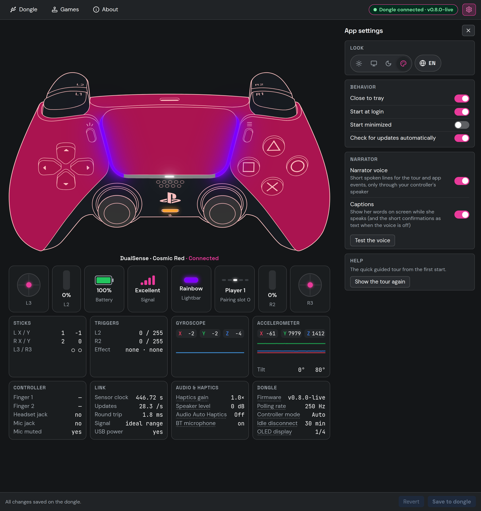
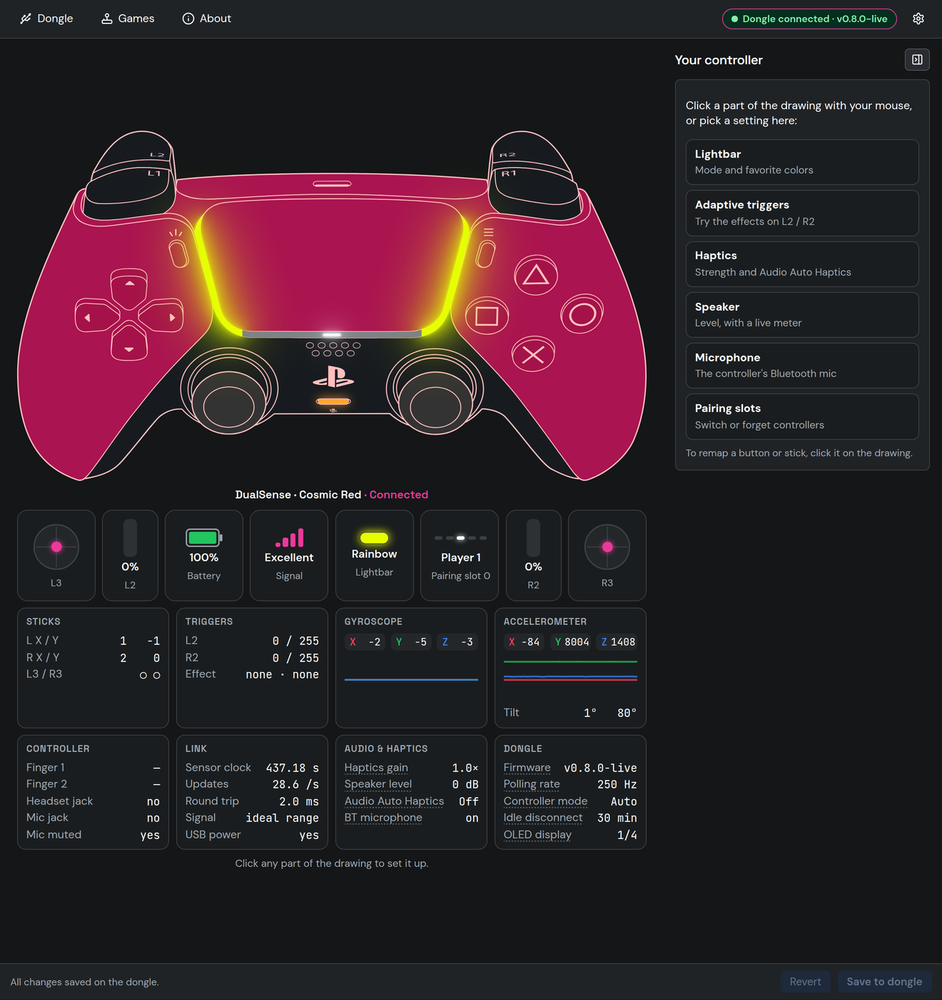
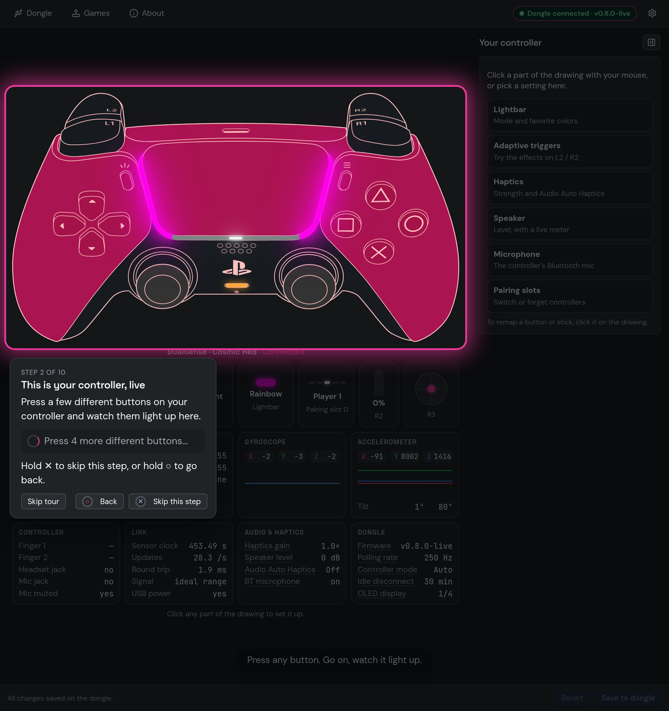
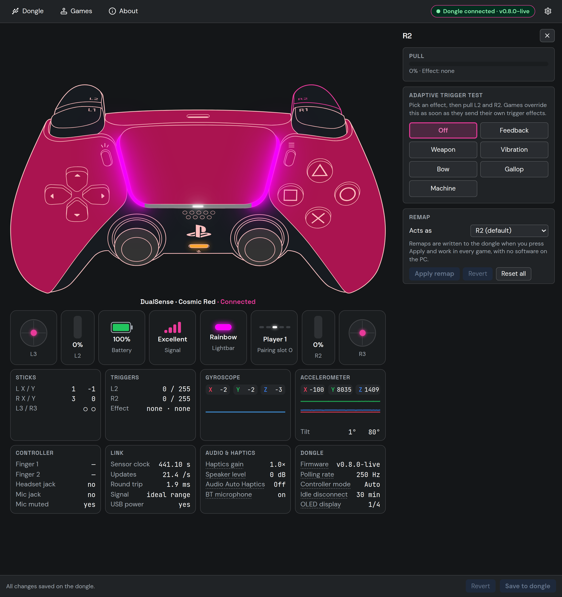
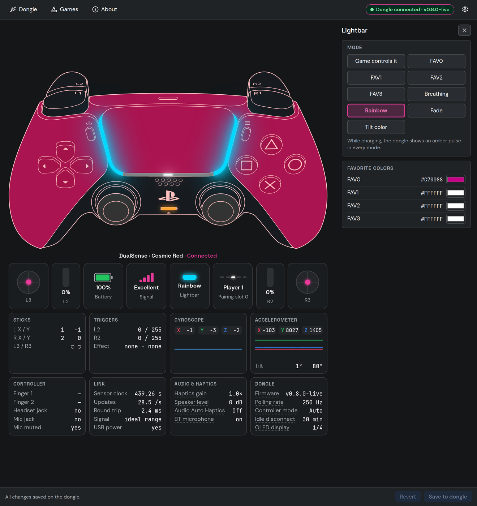
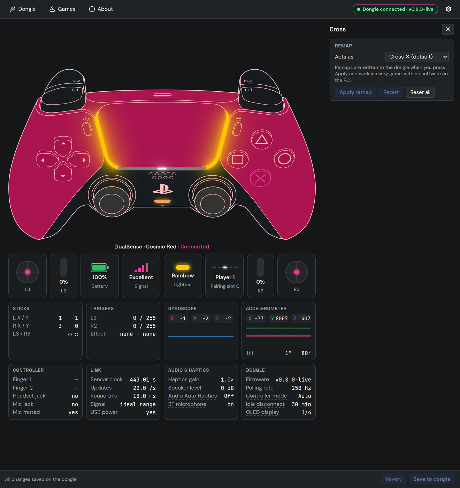
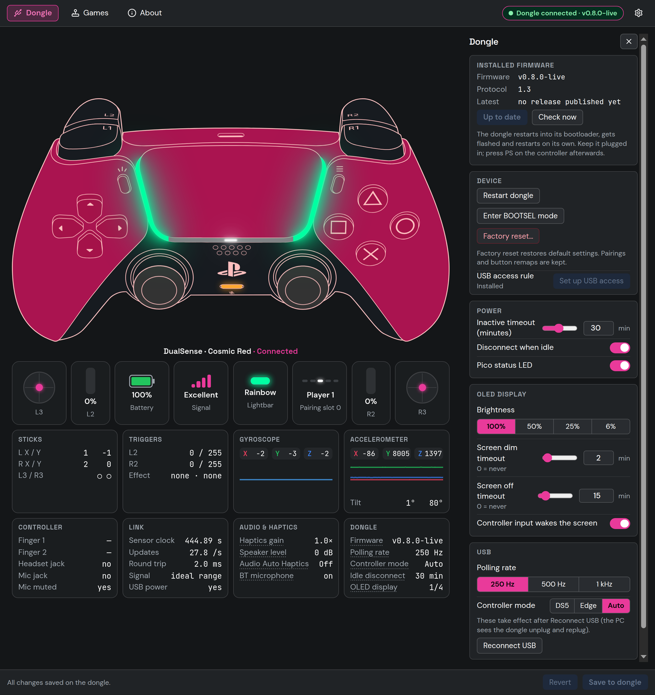
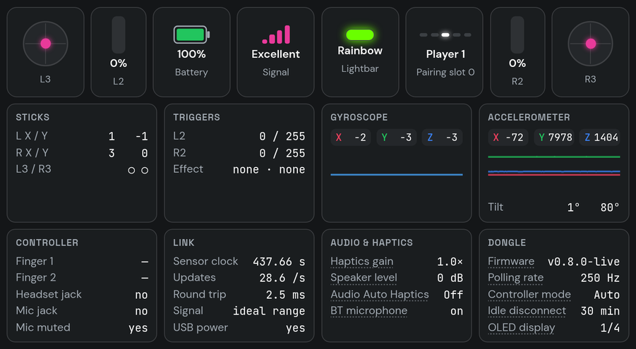

# DS5 Dongle OLED Edition Configurator

The desktop app for the **[DS5 Dongle OLED Edition](https://github.com/MarcelineVPQ/DS5Dongle-OLED-Edition)**: the Raspberry Pi Pico 2 W dongle that connects a DualSense controller to your PC over Bluetooth while looking, to games, exactly like a wired DualSense (adaptive triggers, HD haptics, speaker and mic included).

Linux and Windows (a macOS build is included but hasn't been tested yet). No drivers to install. It updates itself and the dongle's firmware.


## What you can do

Everything happens on one screen. Your controller is drawn in the middle, in its own colors (the app recognizes a Cosmic Red, Midnight Black, Starlight Blue or special-edition DualSense, and the DualSense Edge), and it moves live: buttons light up, L2 and R2 fill as you pull them, the sticks move, touches show on the touchpad, and the lightbar and player indicator glow like the real thing. Below it, a row of live tiles shows the sticks, L2 and R2, battery, signal, the **lightbar mode** with its live color (click it to change it), and your player number and pairing slot. Under the tiles, eight **live data** cards show everything the controller reports: stick and trigger values, the effect each trigger is running, gyroscope and accelerometer with scrolling graphs and tilt, touch points, what's plugged into the controller, the link itself (update rate, round trip, signal), and your audio, haptics and dongle settings at a glance (click any of those lines to open its setting).

**Click any part of the controller with your mouse** to set it up in the panel on the right, or pick a setting from the list there (the panel can be hidden with **»** to make the controller bigger):

| Click | To set up |
| --- | --- |
| The light strips beside the touchpad | Lightbar: game-controlled, four favorite colors, breathing, rainbow, fade, tilt |
| L2 / R2 | Try the adaptive trigger effects, see how far each trigger is pulled and which effect a game is running |
| Any button or stick | Remap it to another button; the map lives on the dongle, so it works in every game with no software on the PC |
| The speaker grille | Speaker level (up to +12 dB), with a live level meter |
| The grips | Haptics strength and Audio Auto Haptics (rumble from game audio for games that send no haptics), with a live meter |
| Mute | The Bluetooth microphone |
| PS | The four pairing slots |

The top bar holds the rest:

- **Dongle:** firmware and one-click updates, OLED brightness and sleep timers, power and idle disconnect, USB polling rate and controller mode, and diagnostics under *Advanced*.
- **Games** (Linux): checks Steam, Heroic and Lutris for settings that block adaptive triggers and haptics, installs the DualSense Proton build, and fixes what it finds once you've reviewed each change. Everything it changes can be undone.
- **About:** what's new in each version, the firmware's changes, this guide, and credits.
- **⚙ App settings:** theme (light, dark, follow the system, or **match your desktop**: your KDE Plasma color scheme, or the system accent color elsewhere), language, close to tray, start at login.

**New here?** The first time a controller connects, a one-minute guided tour walks you through it, hands-on and driven from the controller: press a few buttons, pull a trigger (and feel it push back), click the lightbar. On those play steps ✕ and ○ are just buttons to try: **hold ✕** to move on, hold ○ to go back. Replay the tour any time from ⚙ App settings.

**The narrator.** The tour asks whether you'd like a voice: a narrator who speaks through the **controller's speaker** (never your PC's), in the app's language. She talks you through the tour and confirms things as they happen (saved, remapped, firmware updated). The dongle has her too, so even without the app she says when the controller connects, names the pairing slot you switch to, and warns when the battery runs low. **Captions** show her words on screen (on by default), and with the voice off the confirmations still show as text. Change either in ⚙ App settings → Narrator, where you can also test her voice.



| | |
| --- | --- |
|  |  |
|  |  |
|  |  |



The app keeps running in the **system tray**. The icon shows the controller with its touchpad in your lightbar color, a bolt while charging, and a dot: green connected, amber no controller, grey no dongle. It's dark on a light taskbar and light on a dark one. Right-click it for slots, updates and settings.

Changes apply to the dongle the moment you make them, so you can hear and feel them. **Save to dongle** keeps them after the dongle powers off; **Revert** goes back to what's saved.

## Requirements

- A **Raspberry Pi Pico 2 W** built into a DS5 Dongle OLED Edition (see the [firmware repo](https://github.com/MarcelineVPQ/DS5Dongle-OLED-Edition) for parts and wiring).
- **No firmware yet, or an older one?** The app installs it. Each app release includes the matching firmware, so this works offline:
  1. Plug the Pico in **while holding its BOOTSEL button** (a brand-new Pico doesn't need the button).
  2. The app finds it and offers to install the firmware. One click, no files to copy.

  From then on, the app keeps the firmware up to date for you.

## Install

Download from the **[releases page](https://github.com/MarcelineVPQ/DS5Dongle-OLED-Edition/releases)** on the firmware repo. Every release has the app for each system plus the firmware it was built with (the app includes that firmware, so you don't need to download it separately).

### Linux

1. Download `DS5Dongle-OLED-Edition-Configurator-<version>-linux-x86_64.AppImage`, put it wherever you keep apps, and make it executable (file properties, or `chmod +x`).
2. Run it once. It adds itself to your application menu, and updates keep that entry working.
3. **If the app says it can't open the dongle:** open the **Dongle** page and press **Set up USB access** (asks for your password once). Users with Steam installed usually don't need this.

### Windows

1. Download `DS5Dongle-OLED-Edition-Configurator-<version>-win-x64.exe` and put it somewhere permanent, for example a folder in Documents. It's a portable app, so there's no installer.
2. Run it. The first time, Windows SmartScreen warns that it's unsigned: choose *More info → Run anyway*. The app adds itself to the Start Menu, and the tray menu can also create a desktop shortcut.
3. Windows loads the USB driver for the dongle automatically.
4. **If the dongle doesn't show up** and it was plugged into this PC before updating its firmware: unplug it and plug it back in.

### macOS (untested)

The macOS build hasn't been tested on a Mac yet; reports are welcome.


Download the `.zip`, unzip it, and move the app to *Applications*. The build isn't signed yet, so the first time, right-click the app and choose **Open**. On macOS the app tells you about updates and links to the download, but doesn't install them itself.

## Updates

- **App:** about 20 seconds after it starts (then every 6 hours) the app checks for a new version. If there is one, a banner offers **Download and install**, then **Restart now**. Every download is checked against its published size and SHA-256 before anything is replaced, and the app never installs an older version. Turn automatic checks off in ⚙ App settings or the tray menu.
- **Firmware:** each app release includes the firmware it was built with, and a newer published firmware is offered when there is one. Both appear under **Dongle** (**Check now** looks right away). One click does everything: download and verify, restart the dongle into its bootloader, flash it, wait for it to come back, and confirm the version. Don't unplug the dongle while it runs (about 20 seconds); press **PS** on the controller afterwards.

## Privacy

No accounts, no analytics, no telemetry. The app only goes online to check GitHub for updates and to load the firmware changelog. To show your controller's colors, the dongle reads the colorway code from the controller's factory serial number once when it connects; only those two characters are kept, and they never leave your PC. The Games page reads launcher settings only after you allow it. It can only open the dongle and the dongle's bootloader over USB; every other device and web permission is refused.

## Troubleshooting

| Problem | What to do |
| --- | --- |
| "Plug in the DS5 Dongle" while it is plugged in | On Linux, press **Set up USB access** on that screen. Everywhere: make sure the dongle runs firmware v0.8 or newer. |
| The app window doesn't appear | It may have opened behind other windows, or be in the tray. Click the tray icon. |
| Controller shows "Not connected" | Press **PS** on the controller. After a firmware update or slot switch it doesn't reconnect by itself. A new dongle only appears once a controller is paired: hold **PS + Create** until the light bar flashes. |
| The controller drawing doesn't move | Update the dongle's firmware (the live view needs v0.8 or newer). |
| The narrator is silent | She only speaks through the controller's speaker, and only when the narrator is on (⚙ App settings → Narrator). Check the controller's volume (and that it isn't muted on the PC). The dongle's own lines need firmware v0.8 or newer. |
| Settings reset after unplugging | They were applied but not saved: press **Save to dongle**. |
| Linux with an NVIDIA card | Handled automatically (the app renders without the GPU, which avoids a known Electron crash). |

## Build it yourself

You need [Node.js 22](https://nodejs.org) and Git. On any OS:

```bash
git clone https://github.com/MarcelineVPQ/DS5Dongle-OLED-Config-Web.git
cd DS5Dongle-OLED-Config-Web
npx -y npm@11.6.2 ci          # install dependencies (npm 11; older npm versions crash on this tree)
npm run dist:linux           # Linux AppImage
npm run dist:win             # Windows portable exe (on Windows, or on Linux with Wine)
npm run dist:mac             # macOS zip (on a Mac)
```

The result is in `release/`. The official downloads are built the same way by [GitHub Actions](https://github.com/MarcelineVPQ/DS5Dongle-OLED-Edition/blob/master/.github/workflows/release.yml) on the firmware repo, on real Linux, Windows and macOS machines, so anyone can see exactly how each file was made. Those builds also include the matching firmware; a build you make yourself doesn't, and downloads it from the update feed when you flash.

## For developers

- **Run from source:** `npm run dev:desktop`. Before a pull request, run `npm run check` (typecheck, lint, formatting, security gates, tests).
- **Docs:**
  - [CONTRIBUTING](docs/CONTRIBUTING.md): setup, code style, pre-commit, commit format.
  - [TEST_PLAN](docs/TEST_PLAN.md).
  - [SECURITY_AUDIT](docs/SECURITY_AUDIT.md).
  - [Architecture decisions](docs/adr/README.md).
  - [CLAUDE.md](CLAUDE.md): an architecture overview.
- **Protocol:** the app talks to the dongle over a vendor USB interface using WebUSB; see [ADR-0001](docs/adr/0001-vendor-usb-transport.md) and the firmware's `CLAUDE.md`.
- **Browser version:** this repository still builds the original browser-based config tool (`npm run dev`), but the desktop app is the supported way to configure the dongle.

## Credits

- **Firmware:** [DS5 Dongle OLED Edition](https://github.com/MarcelineVPQ/DS5Dongle-OLED-Edition), a fork of [awalol/DS5Dongle](https://github.com/awalol/DS5Dongle). The browser tool started as [awalol/ds5dongle-config-web](https://github.com/awalol/ds5dongle-config-web).
- **Audio:** The clean controller speaker and Bluetooth mic are [awalol](https://github.com/awalol/DS5Dongle)'s work upstream: the audio path that runs from RAM, the packed audio reports and the mic decoding (and finding the bit that turns the mic on).
- **Thanks** to [loteran/DS5Dongle](https://github.com/loteran/DS5Dongle) (audio fixes, Audio Auto Haptics DSP) and [zurce/DS5Dongle-OLED](https://github.com/zurce/DS5Dongle-OLED) (multi-slot pairing).
- **Live controller art:** DualSense art from the [Gamepad Asset Pack](https://github.com/AL2009man/Gamepad-Asset-Pack) by AL2009man, MIT, modified (recolored and tagged by `tools/prepare_controller_art.py`; license in `src/assets/AL2009MAN-LICENSE.txt`).
- **Tray icon and web tool art:** "PS5 Button Icons and Controls" by [Zacksly](https://zacksly.itch.io), [CC BY 3.0](https://creativecommons.org/licenses/by/3.0/), modified.
- **PICOBOOT flasher:** picoflash by Piers Finlayson (MIT).

DualSense and PlayStation are trademarks of Sony Interactive Entertainment. This project is not affiliated with Sony.

## License

[MIT](LICENSE).
