# DS5 Dongle OLED Edition: the guide

Step by step, from the parts on your desk to every setting in the app. Each section has a picture of exactly what it describes.

- [1. Build your board](#1-build-your-board)
- [2. First start: firmware and pairing](#2-first-start-firmware-and-pairing)
- [3. The Controller page](#3-the-controller-page)
- [4. Each part of the controller](#4-each-part-of-the-controller)
- [5. Calibration](#5-calibration)
- [6. Your board's page](#6-your-boards-page)
- [7. Games](#7-games)
- [8. App settings](#8-app-settings)
- [9. Troubleshooting](#9-troubleshooting)

## 1. Build your board

### Parts

| Part | Notes |
| --- | --- |
| **Raspberry Pi Pico 2 W** | The **Pico 2 WH** has the pin headers already soldered on; the plain Pico 2 W needs two 20-pin headers soldered. The original Pico W (not 2) works without audio. |
| **Waveshare Pico-OLED-1.3** (optional) | The 128×64 screen with two buttons (KEY0 / KEY1). SKU HIPI1798. Everything works without it; the app shows the screen either way. |
| **A USB cable that carries data** | Micro-USB on the Pico's end. Charge-only cables power the Pico but your computer never sees it: if nothing appears, try another cable first. |

### Putting it together

1. **Headers:** solder them on (skip this with a Pico 2 WH).
2. **The screen:** the OLED board plugs straight onto the Pico's headers, no wiring. Seat it with its **KEY0 / KEY1 buttons at the end away from the Pico's USB port** (in the photo below, the USB cable goes in on the right) and press it down evenly.
3. **Plug it in** (next section).

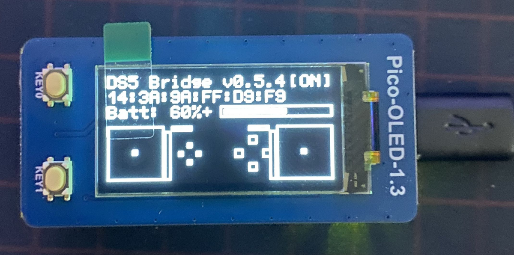

### Which USB port

**Use a USB 2.0 port** (usually the black ones, not blue): best a **USB 2.0 port on the back of the PC** (on the motherboard), or a powered **USB 2.0** hub. Avoid the blue USB 3.x ports: they and USB 3.0 extension cables give off radio noise right in the 2.4 GHz band Bluetooth uses, and the controller then gets stuck on an **amber light bar** and never connects. If you only have USB 3.0 ports nearby, use a short **USB 2.0** extension cable or a powered **USB 2.0** hub to move your board a little away from them. Your board takes its power from the USB port; it needs nothing else.

## 2. First start: firmware and pairing

### Install the firmware

The app includes the matching firmware, so this works offline.

1. **A new Pico:** just plug it in. **A Pico with other firmware on it:** hold its **BOOTSEL** button while you plug it in.
2. The app finds it and offers to **Install the firmware**. One click; keep it plugged in until it's done (your computer may also show a drive called RP2350: you don't need to open it).

### Pair your controller

Hold the **Create button** and the **PS button** on the controller until the light bar blinks. Your board finds it and the app shows it a moment later. A controller that was paired before only needs the **PS button**.

### USB access (Linux)

On Linux, press **Set up USB access** on your board's page once (it asks for your password). It lets the app open your board, and on newer Ubuntu it also lets the app run inside its security sandbox.

## 3. The Controller page

Your controller (a DualSense in its colorway, or a DualSense Edge with its Fn buttons and back buttons), drawn in its own colors, moving as you use it: buttons light up as you press them, the sticks move, the light bar shows its real color. The **rail** on the right takes you to the other pages (hover it for names; pin it open with the button at the bottom, or Ctrl+B).

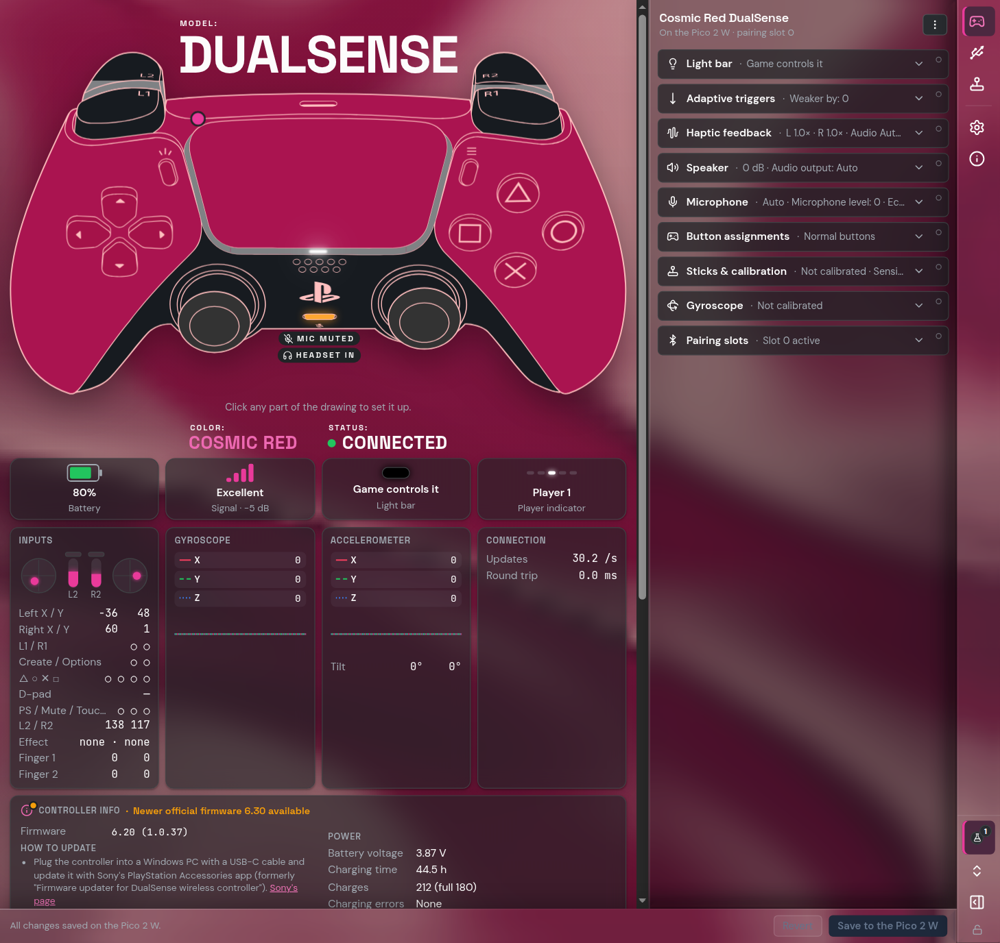

- **Click any part of the drawing** to set it up: its settings open in the panel on the right. Or pick a setting from the list in that panel.
- **The tiles** under the drawing: battery, signal, light bar mode, and the player light and pairing slot.
- **Under the drawing's Mute button:** **Mic muted** while the controller's mute light is on, and **Headset in** while headphones are plugged into its headset jack.
- **The cards**: inputs (sticks, triggers, buttons, touch pad), gyroscope, accelerometer, and the connection (update rate, round trip, headset and mic).
- **Controller info:** the controller's own firmware (version, build date, hardware, bootloader, DSP, Bluetooth patch) with **Up to date** or **Newer official firmware available**, its battery (level, charge state, voltage), and the lifetime counters it keeps itself (time played, charging, haptic feedback and trigger time, charges, connections; in a fold-out, every button's presses and each stick's round trips). **How to update** explains Sony's way: a USB-C cable to a Windows PC with Sony's **PlayStation Accessories** app, or a PS5 (not through your board; pair the controller with your board again afterwards if needed). The app only checks Sony's version list; it never installs Sony firmware. Read only, and the controller's serial number is never read into the app.
- **Changes apply right away.** **Save to the Pico 2 W** (the button names your board) in the bottom bar keeps them after your board is unplugged; **Revert** goes back to what's saved.

## 4. Each part of the controller

### Light bar

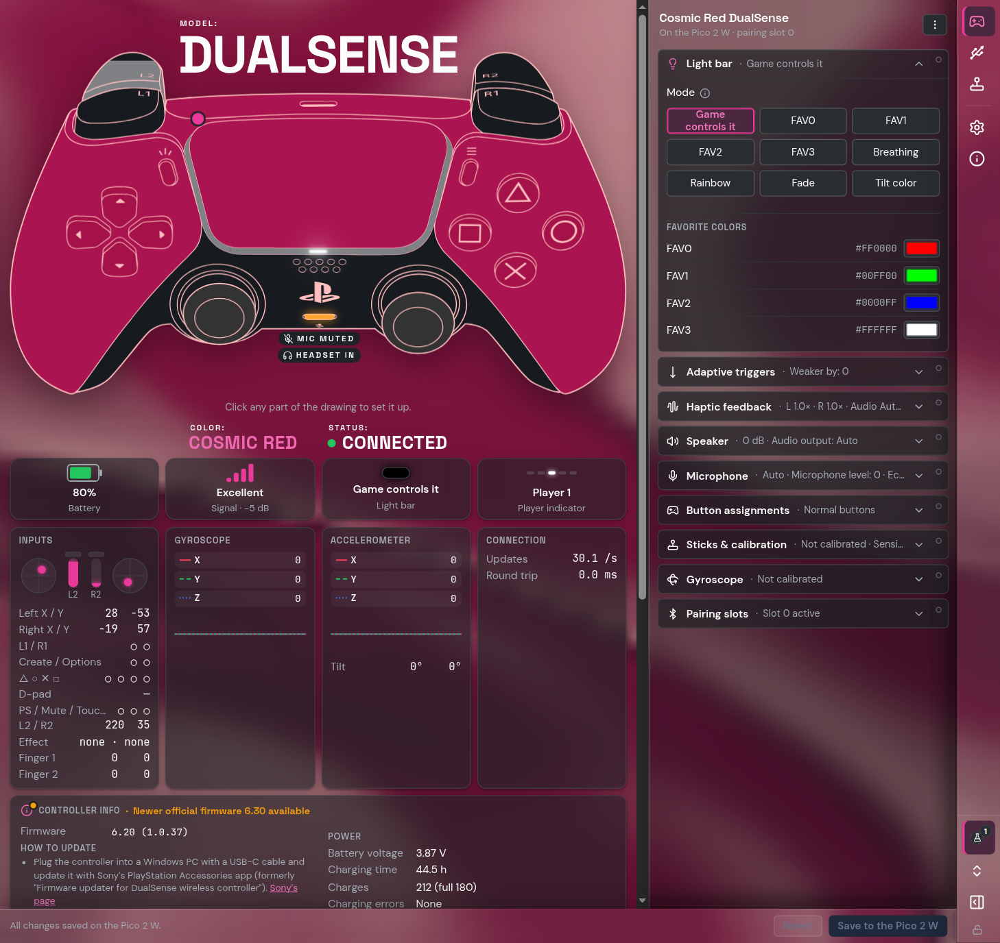

Pick a mode: **Game** (the game decides), one of your four **favorite colors** (FAV0–FAV3), or an effect (breathing, rainbow, fade). Set the favorites with the color pickers.

### Adaptive triggers

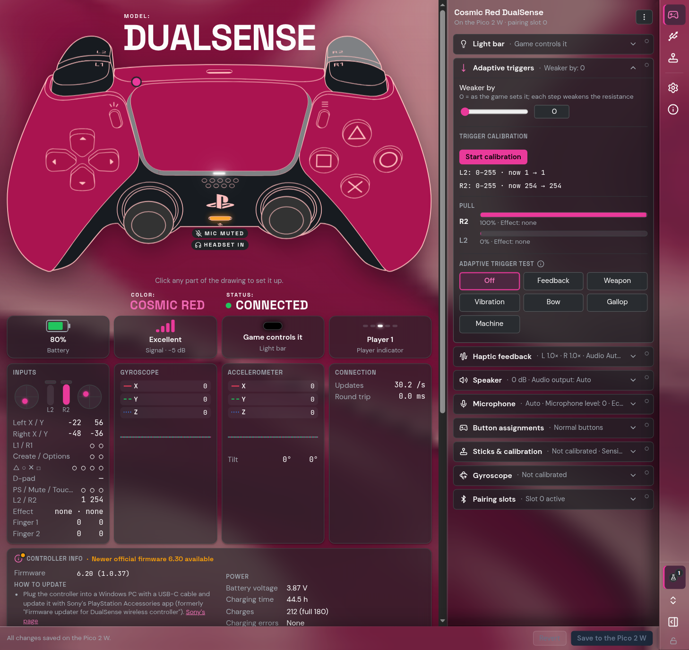

Try the trigger effects games can use (resistance, weapon, vibration…) on L2 and R2. Games set their own effects while you play; this is for feeling what they do and checking the triggers work.

**Trigger Effect Intensity:** makes the games' adaptive trigger resistance weaker, in 10 steps (**Weaker by**); 0, the default, is the game's own strength. It applies to both triggers, and a game's profile can have its own.

### Haptic feedback

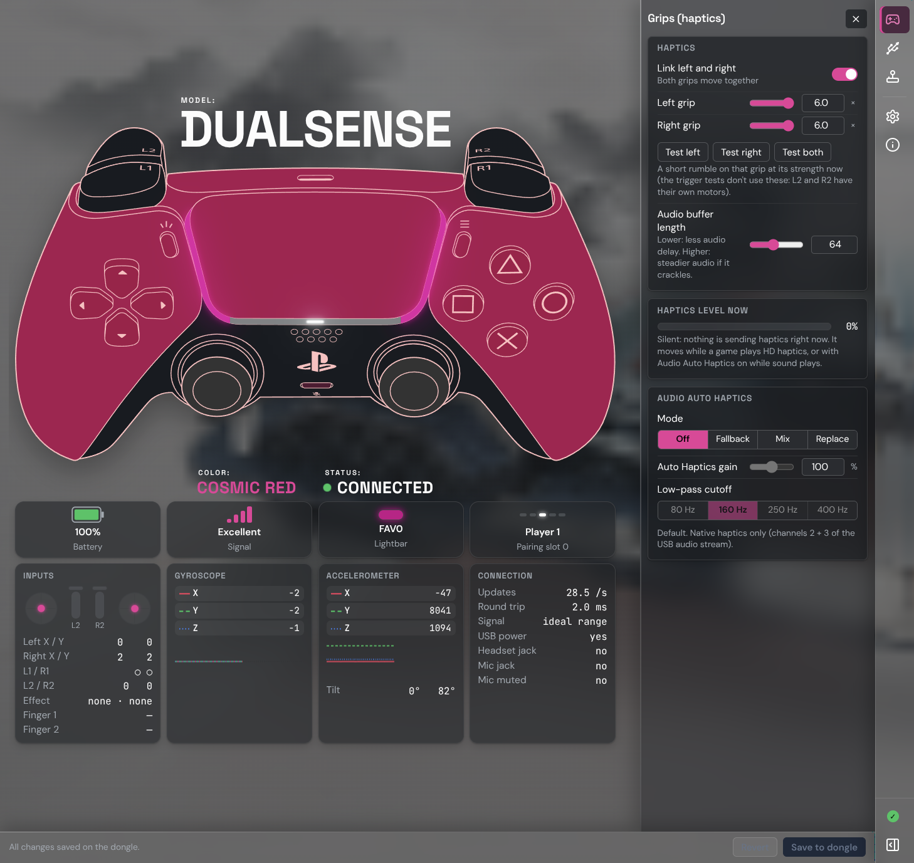

- **Vibration intensity**, per side: **Vibration intensity (left)** and **(right)**, with **Link left and right** to move both together. It scales both kinds of vibration games use: haptic feedback and classic vibration. (The triggers have their own motors; this doesn't change them.)
- **Test left / Test right / Test both:** vibrates that side for 3 seconds at its vibration intensity now, counting down on the button; press it again to stop early.
- **Audio Auto Haptics:** vibration made from the game's sound, for games that send none (or to add to theirs): **Fallback** (only when the game sends nothing), **Mix**, or **Replace**, with its own strength and low-pass filter.

### Speaker and microphone

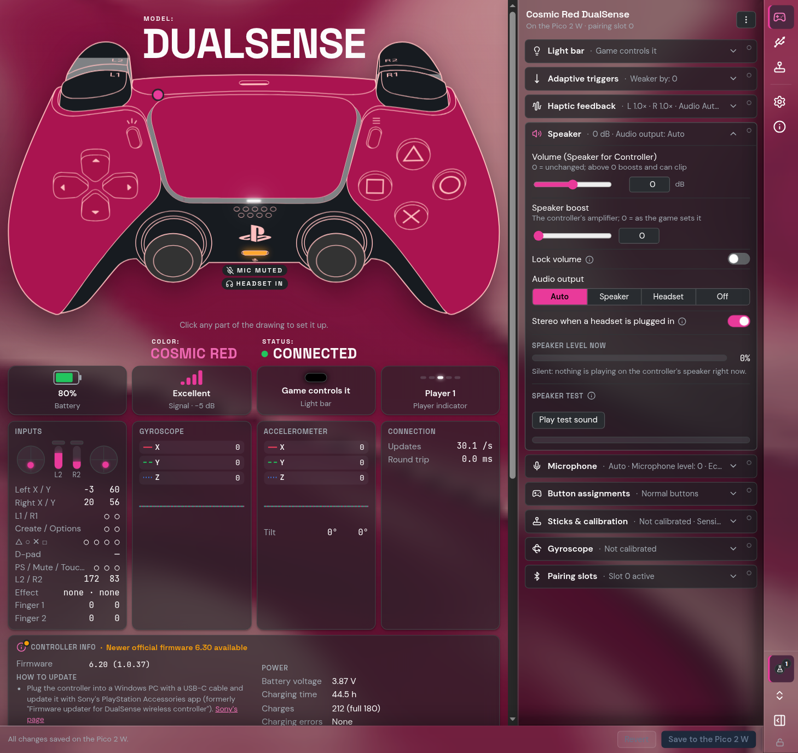

- **Volume (Speaker for Controller)**, with a live meter of what's playing.
- **Speaker boost:** the controller amplifier's own gain, 0 to 7; 0, the default, leaves it as the game sets it. It's separate from the volume slider, which makes the sound itself louder.
- **Lock volume:** games can't change the controller's volume or mute; the PC's own volume and mute still work.
- **Audio output:** where the PC's sound plays: **Auto** (the headset when one is plugged into the controller, else the speaker), **Speaker**, **Headset** or **Off**.
- Speaker boost and Lock volume can be set per game in its profile; Audio output is your board's setting for every game. All three need the newest firmware on your board.
- **Speaker test:** **Play test sound** plays a folk tune, Korobeiniki, twice through (about 77 seconds) on the controller's speaker. The button counts down and a line under it fills; it keeps playing while you go to other pages. **Stop**, or a second press of the button, ends it.
- **Microphone:** turn the controller's built-in microphone on or off (**Built-in microphone**), and choose which one is used (**Microphone used**: **Auto**, which takes a headset's mic when one is plugged in, **Built-in** or **Headset**; the Built-in microphone switch stays the one that turns it off). **Test microphone** records three seconds and plays them back on the controller.

### Button assignments

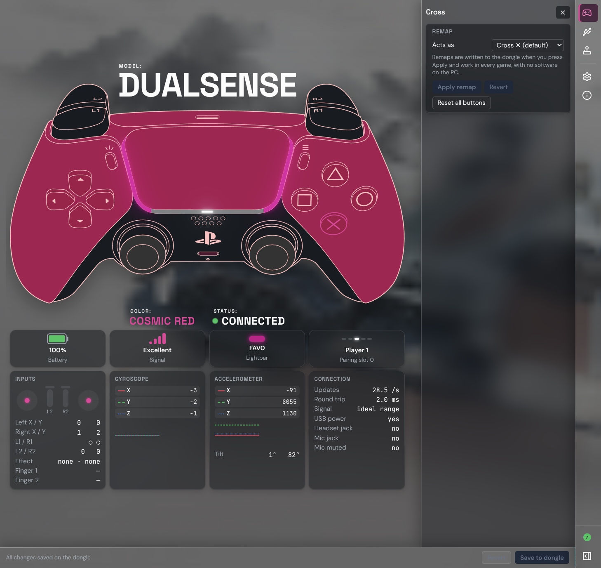

Click a button or stick on the drawing and choose what it **acts as**, or open **Buttons & layouts** (in the controller overview) to see every button in one list, with the changed ones marked. On a DualSense Edge the **Fn buttons** and **back buttons (LB / RB)** are in the list too: each can act as any button, stay itself, or do nothing. Button assignments are stored in your board and work in every game, on any computer.

**DualSense Edge in PlayStation Accessories:** Sony's PlayStation Accessories app (Windows) sees the Edge's own profiles through your board, and a profile you save there shows right away. With **Controller mode** set to **DS5** (USB, on your board's page) it no longer offers a firmware update that then fails.

**Saved button layouts:** save the buttons under a name ("Racing", "Southpaw") and give a layout to any game's profile. It switches in while that game runs (never written to your board's memory, so nothing wears out) and your normal buttons come back when it ends. Each layout lists what it changes ("Cross → Circle · L1 → R1"); edit it once and every game using it follows. Needs the newest firmware on your board.

### Pairing slots

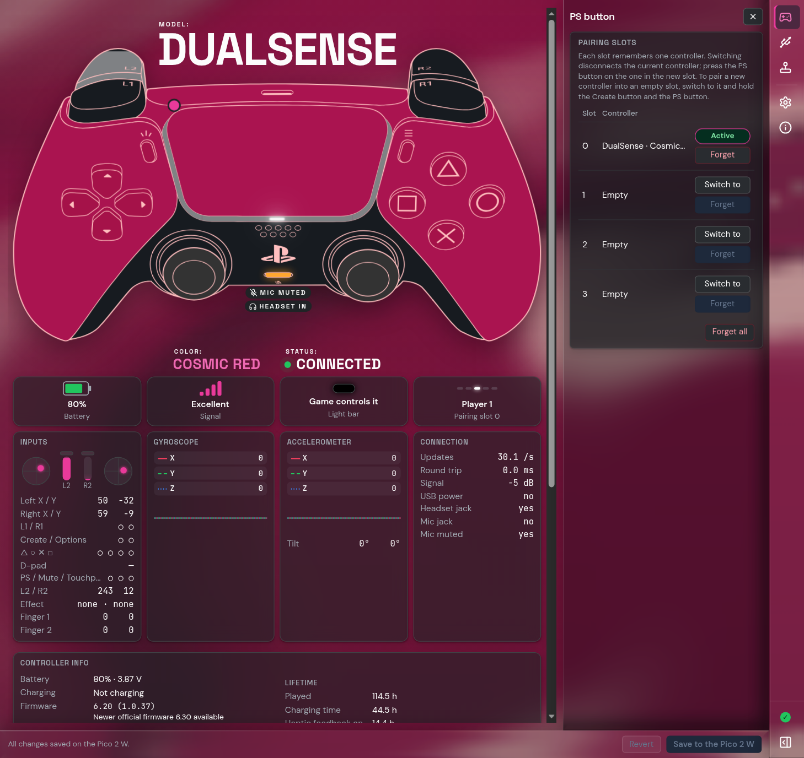

Your board remembers up to four controllers (slots 0–3). **Switch** to another slot, **Forget** one, or forget all. Each slot keeps its own calibration.

## 5. Calibration

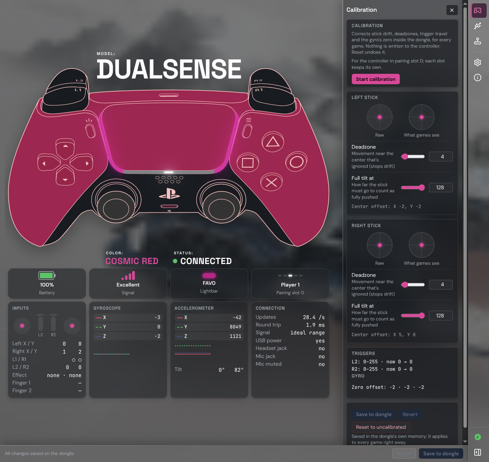

For stick drift, sticks that don't reach the edge, triggers that don't reach full, and a gyroscope that creeps. Open it from the settings list (**Calibration**).

1. **Start calibration** and follow the four steps, each with a short "get ready" pause first:
   1. let go of both sticks;
   2. roll both sticks slowly around their edges;
   3. press both triggers all the way, then let go;
   4. put the controller down and don't touch it.
2. Check the previews: **Raw** (what the stick really does) next to **What games see**. Adjust the **deadzone** and **full tilt** by hand if you like.
3. **Save to the Pico 2 W** (your board's name). It applies to every game right away.

A step that didn't go all the way (a trigger pressed halfway, the controller moved) keeps the old values and tells you which part to redo. Calibration lives in your board, per pairing slot; nothing is written to the controller, and **Reset to uncalibrated** undoes it.

**Sensitivity curve** (below the stick cards): how each stick responds between center and full tilt. Pick **Linear** (the stick as it is), **Precise** or **Steady** (a slow start for fine aiming), **Quick** (a quick start) or **Digital** (almost on/off), or **Custom** and drag its four points (or select one with Tab and move it with the arrow keys). The graph shows the curve against a dashed straight line and a dot where your stick is now; **Save to the Pico 2 W** keeps it for this pairing slot, after the calibration, in every game. A game's profile can use its own curve per stick (pick it in the controller view while you edit the profile), used only while the game runs.

**Stick tests** (below the sensitivity curve): the **circularity test** draws the outline each stick reaches when you roll it around its edge against a perfect circle, with the average error (under about 10% is typical for a healthy DualSense), raw or with your calibration applied. The **drift test** watches the sticks for 10 seconds while you leave them alone and graphs any movement, so you can see whether to recenter or raise the deadzone.

## 6. Your board's page

The side bar names this page after your board (**Pico 2 W**, for example), and the app's buttons and messages use that name too.

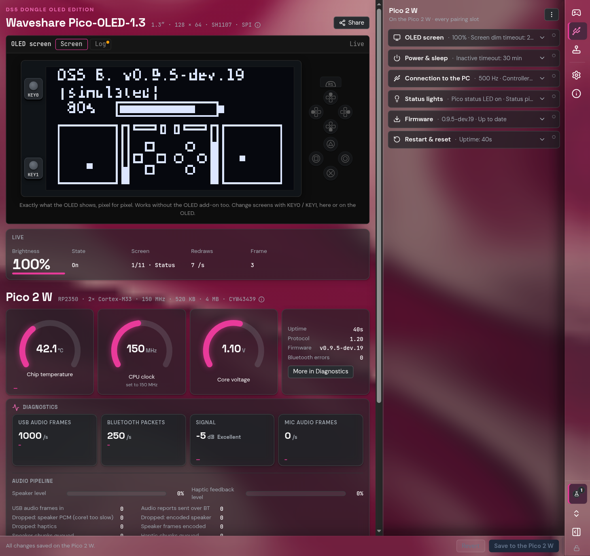

- **Console:** your board's screen, pixel for pixel and live (even without the OLED add-on), and a **Log** of what happened this session. Change screens with KEY0 / KEY1 on your board.
- **The dashboard:** your board's chip temperature, CPU clock and core voltage, and a **Specs** card with its chip (and the clock it runs at), SRAM, flash and wireless chip (Pico 2 W and Pico W); graphs of USB audio, Bluetooth traffic, signal and temperature over the last minute; the audio pipeline's levels and counters (anything that went wrong is marked); and, under **Waveshare Pico-OLED-1.3** (the supported screen add-on), its brightness, state and timeouts, with a **Specs** card for the module (size, resolution, controller, interface, keys). The app can't tell whether the screen is attached: your board drives it whenever it is.
- **Timing** (firmware with protocol 1.11): how long each part of the firmware takes, average and worst case since the last **Reset**, for tracking down audio stutters.

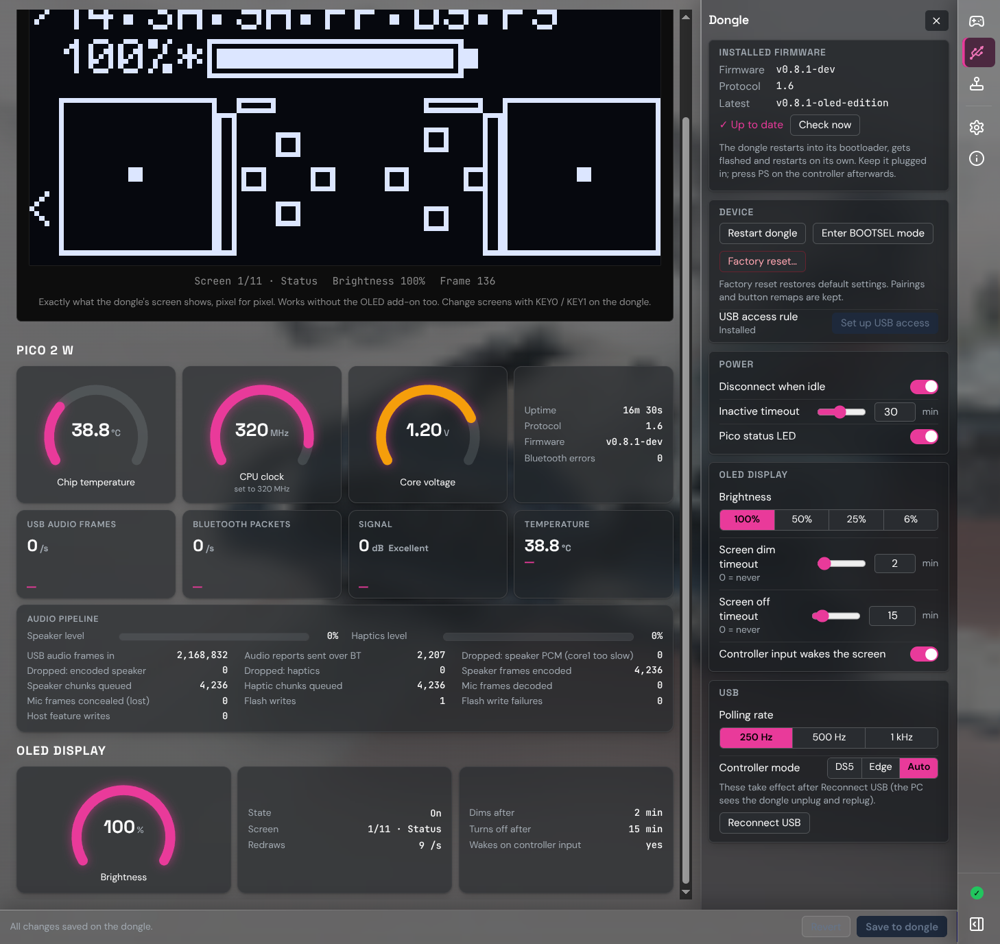

In the panel on the right:

- **Firmware:** what's installed and the latest version. **Check now** looks right away; an update is one click (your board restarts itself; press the PS button on the controller afterwards). While firmware is being written, the app doesn't restart or quit: an app update's **Restart now** waits ("Wait for the firmware update to finish."), and closing the window or quitting from the tray waits until the write is done, then the app closes.
- **Device:** restart your board, enter BOOTSEL, factory reset (keeps pairings and button assignments), USB access (Linux).
- **Power:** disconnect the controller when idle, the timeout, the Pico's status LED.
- **PC sleep:** turn off the controller when the PC sleeps (on by default), and wake the PC with the PS button (off by default; the PC must keep USB powered while it sleeps and allow the keyboard to wake it: with no controller connected, your board appears as "DS5 Dongle Wake Keyboard"). Each switch is saved on your board at once.
- **Waveshare Pico-OLED-1.3:** the screen's brightness, dim and off timeouts, whether controller input wakes it.
- **USB:** polling rate and controller mode (these apply after **Reconnect USB**).
- **Status pin:** a Pico pin (GPIO) that gives 3.3 V while a controller is connected (**On while connected**), or a 0.2 s pulse when one connects (**Pulse on connect**): for an LED (with a resistor) or a PC case's power-button header. Only pins nothing else uses are offered. Needs the newest firmware on your board.

## 7. Games

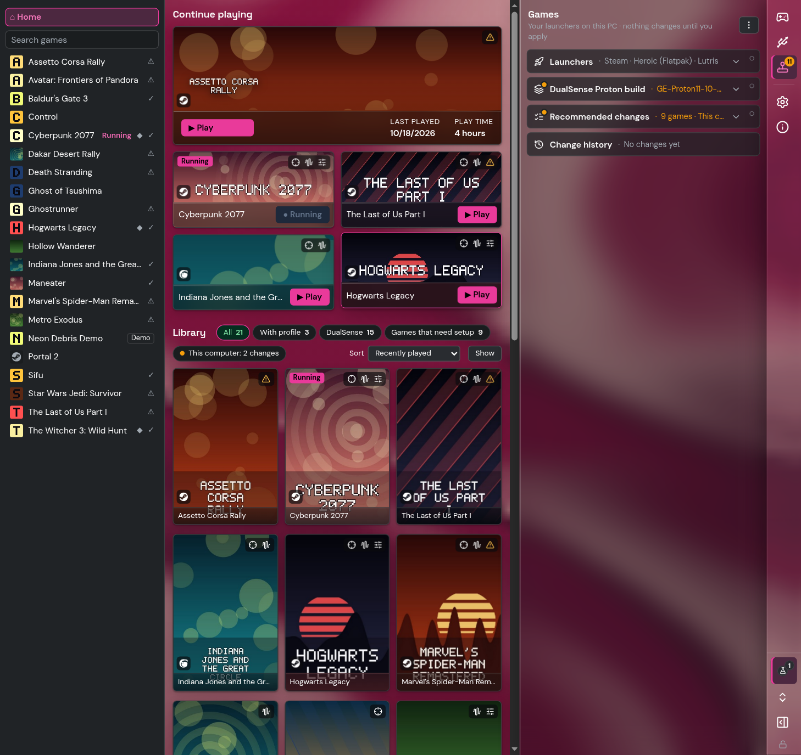

The first time, the app asks before reading anything; it then lists your **Steam, Heroic and Lutris** games, with their artwork from the launchers' own caches (nothing is downloaded). On **Windows** it lists your **Steam, GOG Galaxy and Epic** games; Proton and the system checks are Linux-only, so they don't appear there.

- **Home:** launcher status, our **DualSense Proton** build (install or update it, make it Steam's default), system checks, and fixes it recommends across your games. If Steam, Heroic or Lutris is running when you apply a fix, the review says so: the app closes it to save the change, then opens it again (not while a game is running).
- **A game's page:**

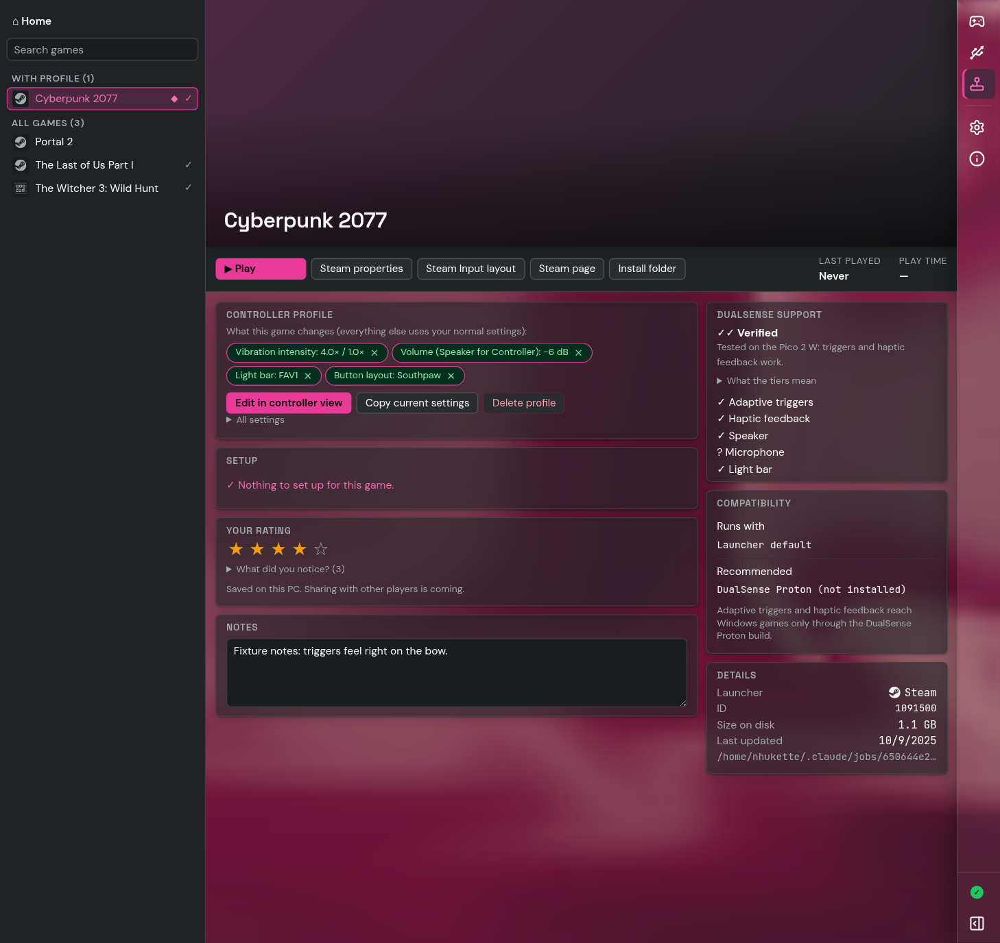

  - **Play**, and links to its Steam properties, Steam Input layout, store page, install folder and Proton prefix. **Play** starts the game with Steam or Heroic staying in the background (the tray) when it wasn't open; if it's already open it gets the game as usual (Heroic then shows its window unless you turn on its setting **Hide Heroic window when launching games from heroic:// links**).
  - **Controller profile:** only what this game changes from your normal settings (haptic feedback, Audio Auto Haptics, the audio buffer, speaker, speaker boost, lock volume, trigger effect intensity, light bar mode and favorite colors, mic, a saved **button layout** and each stick's curve), shown as chips; the × on a chip goes back to your normal setting. **Edit in controller view** puts the profile on the controller so you feel it while you edit (every panel then edits the profile; **Done** brings your normal settings back), and **All settings** is for quick edits. It switches in while the game runs and your normal settings come back when it closes (also after a crash). While you edit or the game runs, the profile is in your board's memory only, never saved to its flash.
  - **Setup:** this game's recommended fixes, applied with a backup you can undo. If the game doesn't react to the controller, tick **Controller not detected** there; if it has HDR on PC and isn't on our list, tick **Supports HDR** (see [HDR in games on Linux](#hdr-in-games-on-linux)).
  - **Compatibility:** which Proton it runs with, and the recommended one (with a one-click switch).
  - **DualSense support:** how well it works (Verified, Works, Needs setup, Partial, Broken) and per feature.
  - **Your rating** and a checklist of what you noticed, and private **notes**. Sharing with other players comes later.

**XInput-only games (Linux).** Some games only know Xbox controllers (Ghostrunner, Control, and others): with our DualSense Proton they see no controller. For those, Games recommends passing the controller as a **standard gamepad (XInput)**: it sets PROTON_PREFER_SDL=1 for that game only, so the game gets an ordinary gamepad with rumble (such games have no adaptive triggers anyway). Our DualSense Proton builds before GE-Proton11-7.2-DualSense ignore this option, so the change also moves the game to a build that honours it (our GE-Proton11-7.2-DualSense or later, else stock GE-Proton). On Steam it's only needed when Steam Input is off for the game; with Steam Input on, Steam already hands the game an Xbox controller. For a game not on our list, tick **Controller not detected** in its Setup to get the same change.

### HDR in games on Linux

Proton normally runs games through XWayland, which has no HDR, so a game like Indiana Jones and the Great Circle says HDR isn't supported even with HDR on for your screen. The way that works is to run the game inside **gamescope**, Valve's compositor (the one the Steam Deck uses), with HDR on. Windows games on Windows do HDR themselves, so all of this is Linux only.

**What the app does.** For HDR games on our list, and any game you mark **Supports HDR** in its page's Setup, Games recommends **Turn on HDR for …** once your computer has everything it needs. It runs the game inside gamescope, full screen at your HDR screen's current resolution, and moves it to our **DualSense Proton** so the controller's adaptive triggers and haptic feedback work together with HDR. Your other launch options stay. Then start the game and turn on HDR in its own display settings. If the game misbehaves, **Undo** puts everything back. A gamescope line you set up yourself counts as done: the app leaves it alone.

**The checklist.** Each HDR game's page shows what HDR needs, each item ✓ or ✗, and every ✗ says what to install or turn on. **Home → This computer → HDR** opens the same list for your computer. The app checks again whenever you open the page (it only reads your settings, it never changes your desktop):

- **A Wayland session.** On the login screen, pick the Wayland session (on KDE Plasma 6 and GNOME it's the default).
- **HDR on for a screen.** KDE Plasma 6: System Settings → Display & Monitor → High Dynamic Range. GNOME 48 or later: Settings → Displays → HDR. The app reads this on KDE Plasma and GNOME only; on other desktops it doesn't offer the change, but the manual way below can still work. (We've tested on KDE Plasma; the GNOME check follows GNOME's documented display settings interface but hasn't been tried on a GNOME machine yet.)
- **gamescope 3.15 or later** (3.16.5 or later on GNOME), with its **HDR layer** (the Vulkan layer `VkLayer_FROG_gamescope_wsi`, which comes with gamescope):
  - Ubuntu and Debian: `sudo apt install gamescope` (checked on Ubuntu 26.04: gamescope 3.16.20, layer included).
  - Arch: `sudo pacman -S gamescope` (in the extra repository, layer included).
  - Fedora: `sudo dnf install gamescope` (the package exists; we haven't checked the version or the layer on each Fedora release: the checklist tells you).
  - Steam, Heroic or Lutris installed as a **Flatpak**: they can't use the system's gamescope. Install the Flatpak one with `flatpak install flathub org.freedesktop.Platform.VulkanLayer.gamescope` and pick the branch that matches the launcher's runtime.
- **Our DualSense Proton** (Games → Home → Proton card). Other Proton builds may work with gamescope too, but ours is the one we test, and it gives you the controller's triggers and haptics with HDR.
- **A graphics driver gamescope works with.** Tested: NVIDIA RTX 5080 with driver 615 on KDE Plasma 6. Gamescope needs NVIDIA 515 or later at all; we haven't checked the minimum NVIDIA or Mesa (AMD, Intel) version for HDR.
- **A game with HDR** (its own HDR setting on PC).

**Doing it yourself.** The game page's **Set it up yourself** shows these steps with your screen's resolution filled in and a line to copy.

1. Use our DualSense Proton for the game. Steam: the game's Properties → Compatibility → tick **Force the use of a specific Steam Play compatibility tool** → pick it. Heroic: the game's Settings → **Wine Version**. Lutris: Configure → Runner options → **Wine version**.
2. Steam: in Properties → General → **Launch Options**, put:

   `ENABLE_GAMESCOPE_WSI=1 gamescope --backend wayland --hdr-enabled -f -W 3840 -H 2160 --force-grab-cursor -- %command%`

   - `ENABLE_GAMESCOPE_WSI=1` turns on gamescope's Vulkan layer for the game, which is how the game's picture reaches gamescope in HDR.
   - `gamescope … --` runs the game inside gamescope; everything after `--` is the game.
   - `--backend wayland` makes gamescope a window of your desktop (a Wayland window, which can be HDR), and `--hdr-enabled` turns HDR on in gamescope.
   - `-f` full screen; `-W 3840 -H 2160` gamescope's size: **use your own screen's resolution** (the app fills in the current mode of your HDR screen).
   - `--force-grab-cursor` keeps the mouse inside the game (some games otherwise lose the mouse or the camera points at the floor).
   - `%command%` is the game itself. Variables you already use (for example `PROTON_PREFER_SDL=1`) go at the very start; other tools (`mangohud`, `gamemoderun`) go after `--`; game arguments go after `%command%`.

   Heroic: the game's Settings → **Gamescope**: turn on **Enables Upscaling**, set Game Width / Upscale Width and Game Height / Upscale Height to your resolution, window type **Fullscreen**, and **Additional Options** `--backend wayland --hdr-enabled --force-grab-cursor`; in Settings → Advanced → **Environment Variables** add `ENABLE_GAMESCOPE_WSI` = `1`. Lutris (0.5.17 or later): Configure → System options (tick **Advanced**) → Gamescope: **Enable Gamescope**, **Enable HDR**, **Relative Mouse Mode**, Output and Game Resolution your resolution, Window Mode **Fullscreen**, **Custom Settings** `--backend wayland`; in System options → **Environment variables** add `ENABLE_GAMESCOPE_WSI` = `1`.
3. Start the game and turn on HDR in its own display settings.

**DirectX games** (most Windows games, through DXVK and vkd3d-proton) only offer HDR when `DXVK_HDR=1` is set. You don't need to add it: gamescope sets it for the game itself when HDR is on (and Lutris's Enable HDR sets it too). DXVK leaves HDR off in DirectX 11 Unreal Engine 4 games on purpose.

**If it doesn't work:**

- **Black screen, no sound** with `PROTON_ENABLE_WAYLAND=1` and `PROTON_ENABLE_HDR=1` in the launch options (the app's first HDR version set these): remove both and use the gamescope line. The app offers this as **Move … HDR to gamescope** (or **Remove the old HDR setting** until gamescope is ready); on Heroic it also turns off the game's **Enable Wine-Wayland** and **Enable HDR**.
- **The game says HDR isn't supported by the hardware:** go through the checklist on the game's page: HDR on for the screen the game shows on, gamescope new enough with its HDR layer, the gamescope line in place.
- **The game starts on the wrong screen or at the wrong size:** gamescope opens on the screen your desktop puts new windows on; check `-W` / `-H` match that screen.
- We haven't checked whether the Steam overlay shows inside gamescope.

## 8. App settings

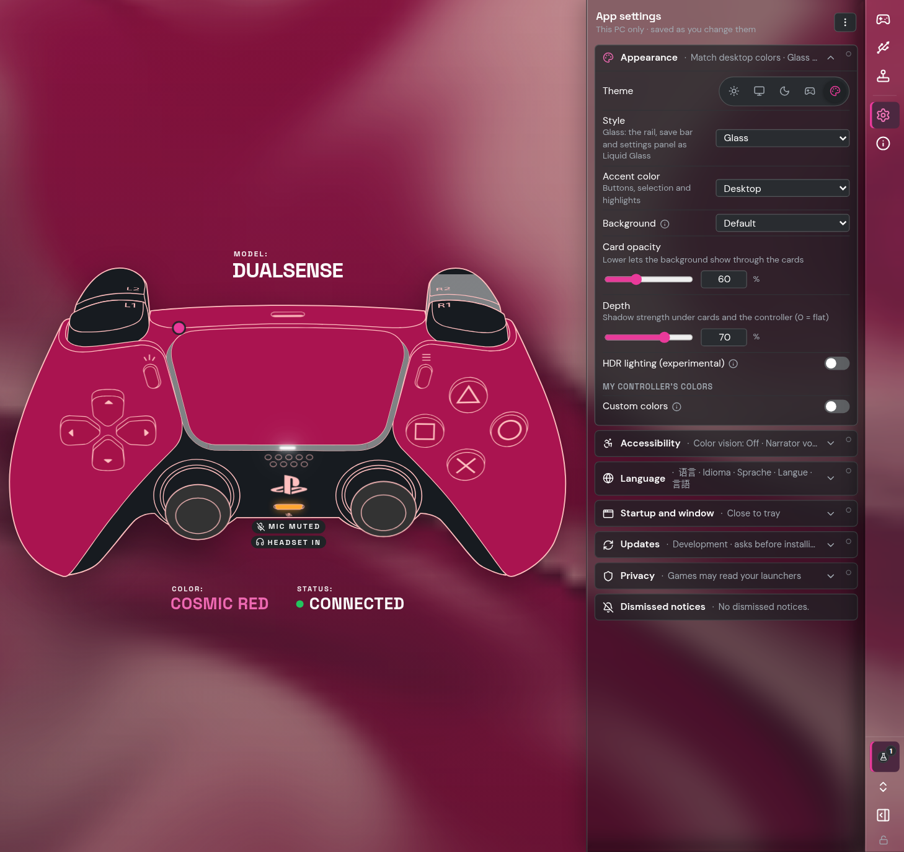

Open with the ⚙ in the rail.

- **Language.**
- **Appearance:** theme (**Match my controller**, light, dark, or your desktop's colors), style (**Standard** or **Glass**), accent color, and the look sliders: **card opacity** (let the game art through), **background dim**, **background blur** and **depth** (shadow strength).
- **Accessibility:** **Color vision** modes (colors never carry meaning alone anyway), **Reduce motion**, the **narrator** voice and captions.
- **Startup and window:** close to tray, start at login, start minimized.
- **Updates:** check automatically, install automatically, and the **update channel**: Stable (the default) or **Development**, which brings development builds of the app and firmware before they're released (newer, less tested), plus every stable release. **Back to stable** returns to the latest stable app and firmware.
- **Advanced:** **hardware acceleration**, and **HDR lighting** (experimental: on an HDR display the light bar glows brighter than white, at the peak brightness you set in nits).

## 9. Troubleshooting

| Problem | What to do |
| --- | --- |
| The light bar stays **amber** and never connects | Move your board to a **USB 2.0** port, or onto a short USB 2.0 extension away from USB 3.0 ports (radio noise; see [Which USB port](#which-usb-port)). Leave it 10–20 s: the firmware retries on its own. |
| **Windows:** "The Pico 2 W is plugged in, but Windows hasn't set up its driver", or it never connects | Press **Repair USB driver** on that screen, allow the admin prompt, then unplug your board and plug it back in. It happens on PCs where a real DualSense was plugged in by USB before (it uses the same USB IDs); do it again if that happens again. |
| Nothing shows up when your board is plugged in | Try another cable (charge-only cables don't carry data). On Linux, press **Set up USB access**. |
| The controller connects, then drops right away | Charge it: a controller that disconnects straight after connecting usually has a low battery. |
| "Not connected" | Press the **PS button** on the controller. After a firmware update or a slot switch it doesn't reconnect by itself. A new controller: hold the **Create button** and the **PS button**. |
| Settings reset after unplugging | They were applied but not saved: press **Save to the Pico 2 W** (your board's name). |
| The drawing doesn't move, or a page says "update the firmware" | Update your board's firmware from your board's page. |
| The narrator is silent | She speaks only through the controller's speaker, and only when the narrator is on (App settings → Accessibility). Check the controller's volume. |
| The app window doesn't appear | It may be in the tray: click the tray icon. |
| A soft reboot without unplugging | Hold **PS + Mute** for 2 seconds, or **KEY0 + KEY1** on the OLED for 1 second. |
